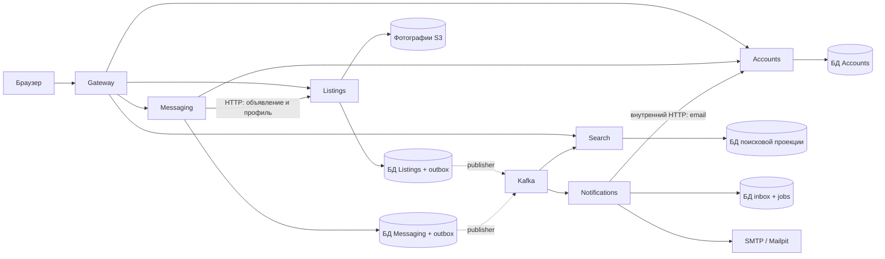

# Рядом — учебный маркетплейс на Go

Небольшой аналог Авито для изучения Go. Вместо одной большой программы здесь работают шесть небольших сервисов: каждый отвечает за свою часть приложения. На этом примере можно разобраться, как сервисы хранят данные, обмениваются событиями через Kafka и продолжают работу после сбоя.

Пользователь регистрируется, создаёт черновик, добавляет фотографии, публикует объявление и находит его в каталоге. Другой пользователь пишет продавцу; уведомление приходит в локальный почтовый ящик. Есть редактирование профиля, снятие с продажи, повторная публикация и история переписки. Сделка происходит вне приложения.

Это работающий учебный проект с эксплуатационными механизмами. Для реальных пользователей потребуется отдельно настроить инфраструктуру, защиту от злоупотреблений, резервное копирование и проверить нагрузку.

**Начните с [подробного руководства](docs/README.md).** Оно написано простым языком: [первый запуск](docs/guide/getting-started.md), [пользовательский сценарий](docs/guide/user-guide.md), [путеводитель по коду](docs/guide/code-tour.md), [примеры API](docs/guide/api-walkthrough.md) и [словарь терминов](docs/guide/glossary.md). Ниже оставлена короткая памятка для повторных запусков.

## Быстрый старт

Нужны Docker Engine с Compose v2+, Go 1.27.1 и Make. Для браузерных тестов дополнительно нужны Node.js/npm и Chromium Playwright; для Kubernetes — `kubectl`. На первый запуск заложите время на скачивание образов и сборку. Практический ориентир для Docker — 8 ГБ RAM и 4 CPU; одновременные Compose, наблюдаемость и kind потребуют больше памяти. Это ориентир, а не результат нагрузочного теста.

Из корня репозитория:

```sh
make up
make seed
```

`make up` генерирует случайные локальные секреты в `.local/.env`, собирает образы, запускает зависимости, применяет миграции и ждёт готовности сервисов. Повторный `make setup` сохраняет уже созданные значения. Файл с секретами исключён из Git.

Откройте:

| Что | Адрес |
|---|---|
| Приложение | http://127.0.0.1:8080 |
| Письма в Mailpit | http://127.0.0.1:8025 |
| PostgreSQL для локальной отладки | `127.0.0.1:15432` |
| Kafka для утилит с хоста | `127.0.0.1:19092` |
| S3 API для фотографий | `127.0.0.1:9000` |

Используйте именно `127.0.0.1`: это также настроенный Origin для refresh/logout и адрес в ссылках приложения.

Демопользователи — **anna@example.com** и **boris@example.com**. Общий демонстрационный пароль находится в `.local/.env`, поле `DEMO_PASSWORD`. Seed создаёт восемь объявлений Анны с иллюстрациями; повторный запуск пропускает объявления с уже существующими демоназваниями.

Для проверки откройте приложение в двух браузерных профилях: под Борисом найдите объявление Анны и отправьте сообщение. Под Анной откройте переписку, а письмо посмотрите в Mailpit. Поиск обновляется асинхронно, поэтому после публикации возможна небольшая задержка.

## Как устроен проект



| Каталог | С чего начать |
|---|---|
| `cmd/<service>/` | Сборка зависимостей и запуск каждого процесса |
| `services/accounts/` | Пароли, JWT, ротация refresh token, публичный профиль |
| `services/listings/` | Права владельца, версии объявления, фотографии, outbox |
| `services/search/` | Проекция, полнотекстовый поиск PostgreSQL, переиндексация |
| `services/messaging/` | Участники диалога и идемпотентная отправка сообщений |
| `services/notifications/` | Inbox, задания, аренда задания worker-ом и SMTP |
| `services/gateway/` | Разрешённые маршруты, rate limit, встроенный веб-интерфейс |
| `internal/platform/` | HTTP, конфигурация, авторизация, Kafka, outbox, телеметрия |
| `api/` | OpenAPI и JSON Schema событий |
| `tests/` | Интеграционные, сквозные, браузерные тесты и сценарии отказов |
| `deploy/` | Compose, наблюдаемость, Helm и локальный kind |
| `docs/` | Архитектура, инструкции эксплуатации и упражнения |

Сервисы имеют отдельные точки входа, образы и базы. Единый Go module упрощает обучение и сборку; это не разрешение читать таблицы соседнего сервиса.

## Команды для работы

```sh
make logs               # JSON-логи всех сервисов
make down               # остановить стенд, сохранив тома с данными
make up                 # пересобрать изменённый код и запустить
make observability-up   # добавить Collector, Jaeger, Prometheus и Grafana
```

После подключения наблюдаемости: [Grafana](http://127.0.0.1:13000), [Jaeger](http://127.0.0.1:16686), [Prometheus](http://127.0.0.1:19090). Логи пишутся через `log/slog` в stdout; OpenTelemetry переносит контекст и экспортирует **трассировки**. Логовое хранилище вроде Loki в стенд не включено.

```sh
make lint               # gofmt и go vet
make test               # Go-тесты с race detector
make test-integration   # нужны PostgreSQL, Kafka и S3 из Compose
make smoke              # нужен работающий весь стенд, проверяется также письмо
cd tests/browser && npm ci && npx playwright install chromium && cd ../..
make test-browser
make test-resilience    # останавливает и запускает Kafka/Search этого стенда
make contracts-check    # после npm ci в tests/browser
make tools              # локальные Helm, kind и kubeconform в .local/bin
make helm-check
```

`make check` объединяет lint, Go-тесты, интеграционные тесты и smoke. Браузерные тесты, сценарии отказов и Helm проверяются отдельными командами. Выполнение команды в этом списке не означает, что конкретная проверка уже прошла в вашем окружении.

Примеры публичного API:

```sh
curl -fsS http://127.0.0.1:8080/api/v1/categories
curl -fsS 'http://127.0.0.1:8080/api/v1/search?q=велосипед&category_id=sport&min_price=100000&max_price=2000000&limit=20&page=1'
curl -fsS http://127.0.0.1:8080/health/ready
```

Цены API передаются целым числом в **копейках**. Мутации объявления используют `expected_version`; отправка сообщения требует `Idempotency-Key`. Подробные тела запросов и ответы — в [OpenAPI](api/openapi.yaml).

## Куда идти дальше

- [Полное оглавление документации](docs/README.md): последовательный маршрут от первого запуска до разбора сбоев.
- [Как запускать и понимать тесты](docs/guide/testing.md).
- [Архитектура и принятые решения](docs/architecture/overview.md): границы сервисов, Kafka, версии, надёжность и ограничения.
- [Локальная разработка и диагностика](docs/runbooks/local-development.md): логи, подключения, пересборка и очистка.
- [События и восстановление Search](docs/runbooks/events.md): DLQ, replay, переиндексация.
- [Развёртывание и резервное копирование](docs/runbooks/deployment-and-backups.md).
- [Локальный Kubernetes](deploy/kind/README.md).
- [Упражнения со сбоями](docs/exercises/failures.md).
- [Результаты проверки стенда](docs/verification.md): выполненные проверки, версии окружения и границы подтверждённых гарантий.

В первой версии нет платежей, доставки, модерации, проверки email, сброса пароля, избранного и WebSocket. JWT использует один ключ без бесшовной ротации, внутренние API — общий `SERVICE_TOKEN`; rate limit хранится в памяти каждого Gateway. Локальные один брокер Kafka и один сервер PostgreSQL не обеспечивают отказоустойчивость к потере узла. Эти упрощения и границы гарантий разобраны в архитектуре.
