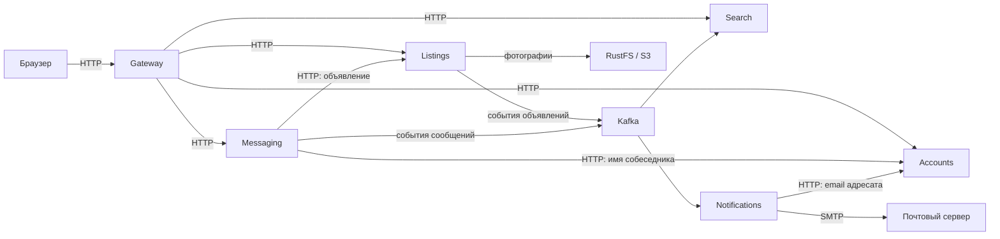
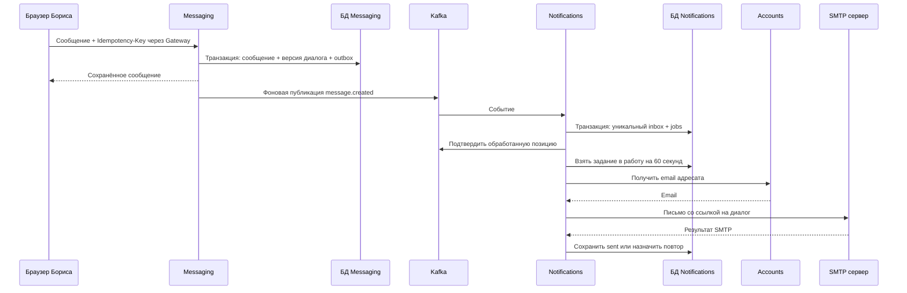

# Как устроен проект

[К оглавлению](../README.md)

Это учебная доска объявлений: продавец публикует товар, покупатель находит его и пишет продавцу. Ниже разобраны не только части системы, но и путь конкретного действия между ними. Чтобы затем найти всё это в Go-коде, откройте [путеводитель по исходникам](../guide/code-tour.md). Незнакомые слова собраны в [словаре](../guide/glossary.md).

## Шесть сервисов и их обязанности

**Сервис** здесь — отдельная запущенная Go-программа со своей работой. **API** — адреса и правила запросов, с помощью которых браузер или другой сервис обращается к этой программе. Исходники лежат в одном репозитории, но программы запускаются отдельно.

| Сервис | За что отвечает | Какие данные хранит |
| --- | --- | --- |
| Gateway | Принимает запросы браузера, отдаёт страницы, направляет запросы в нужный сервис | Собственной базы нет; счётчики ограничения запросов находятся в памяти процесса |
| Accounts | Регистрация, вход, обновление сессии, профиль | `users` — пользователи; `sessions` — сессии обновления доступа |
| Listings | Объявления, категории, состояния публикации и фотографии | `listings`, `categories`, `photos`, `outbox` |
| Search | Каталог, поиск по тексту, категории и цене | `items` — поисковые копии; `projections` и `settings` — наборы копий и выбор активного набора |
| Messaging | Диалоги и сообщения между покупателем и продавцом | `conversations`, `messages`, `outbox` |
| Notifications | Принимает события о сообщениях и отправляет email | `inbox` — уже принятые события; `jobs` — задания отправки |

**PostgreSQL** — программа для хранения таблиц и выполнения SQL-запросов. У пяти сервисов есть отдельные базы PostgreSQL и отдельные роли подключения. В локальном запуске базы находятся на одном сервере PostgreSQL: «своя база» не означает «отдельный контейнер на каждый сервис».

**Kafka** хранит события, то есть записи о произошедших изменениях. **S3** — API для хранения файлов как объектов; локально его предоставляет RustFS. **SMTP** — протокол передачи писем; локально письма принимает Mailpit, где их можно посмотреть без отправки реальным адресатам.



Базы на схеме опущены ради читаемости: каждый сервис с хранилищем обращается к своей базе. Кроме перечисленных прикладных таблиц, инструмент миграций ведёт техническую `schema_migrations`: она хранит состояние применения изменений структуры. Search реализован средствами PostgreSQL, включая полнотекстовый поиск на русском языке. Elasticsearch, Redis и отдельного поискового кластера в проекте нет.

## Почему нельзя просто прочитать чужую таблицу

Listings владеет объявлением: только он решает, кто может его изменить и готово ли оно к публикации. Accounts владеет email и паролем. Messaging хранит текст переписки. Search получает лишь копии публичных данных объявления; он не становится владельцем оригинала.

Например, `owner_id` в базе Listings — идентификатор пользователя из Accounts. Это значение UUID, то есть уникальная строка вида `a1b2…`, а не SQL-связь с таблицей `users` в другой базе. Внешние ключи, проверяемые самой БД, связывают только местные таблицы: например, `photos.listing_id` с `listings.id`.

Сервисы не выполняют SQL JOIN между своими базами. Когда Messaging нужно узнать продавца и статус объявления, он вызывает внутренний API Listings. Когда Notifications нужен email, он обращается к Accounts. Изменение таблиц одного сервиса поэтому не требует, чтобы все остальные знали их устройство.

Это разделение требует учитывать сбои сети. Успешный запрос к Listings и последующая запись в Messaging не составляют одну общую транзакцию. **Транзакция** — несколько операций с БД, которые сохраняются вместе либо отменяются вместе. В проекте транзакции действуют внутри одной базы; общей транзакции между сервисами нет.

## HTTP и Kafka решают разные задачи

**HTTP** работает как «вопрос — ответ»: вызывающая сторона ждёт результат. Браузер отправляет запрос создания объявления и получает его ID. Messaging при открытии нового диалога спрашивает Listings, опубликовано ли объявление и кто его продавец. Если Listings недоступен, открыть новый диалог этим путём не получится.

**Kafka** используется, когда обработка может произойти позже. Listings сохраняет факт публикации, а Search затем обновляет каталог. Messaging сохраняет сообщение, а Notifications позже готовит письмо. Ответ пользователю не ждёт обновления поиска или успешной отправки email.

Отсюда **согласованность с задержкой**: карточка в Listings уже обновлена, но поисковая копия ещё старая. Через некоторое время, если зависимости исправны и события обработаны, Search догонит Listings. Время задержки не фиксировано: при сбое Kafka или Search оно увеличивается.

Запрос чтения карточки `/api/v1/listings/{id}` идёт в Listings. Запрос каталога `/api/v1/search` — в Search. Это объясняет, почему сразу после изменения цена в карточке и цена в каталоге иногда временно различаются.

## Один пример: публикация велосипеда

Допустим, Анна продаёт велосипед. Она уже зарегистрировалась, заполнила название, описание, категорию и цену.

1. `POST /api/v1/listings` создаёт черновик со статусом `draft` и версией `1`. Черновик видит его владелец. Событие в Kafka при создании черновика не создаётся.
2. Анна загружает фото. После успешного завершения загрузки версия объявления увеличивается, например до `2`. Изменение черновика тоже не создаёт публичное событие.
3. Браузер получает текущую карточку и отправляет запрос публикации с `expected_version: 2`.
4. Listings проверяет пользователя, блокирует строку объявления на время транзакции, проверяет владельца и совпадение версии. Затем проверяет обязательные поля и наличие готового фото.
5. Listings меняет статус на `published`, увеличивает версию до `3` и в той же транзакции добавляет запись в `outbox`.
6. После сохранения транзакции пользователь получает карточку. Дальнейшая доставка события выполняется фоном.
7. Фоновый отправитель читает outbox, публикует событие в Kafka и помечает запись отправленной.
8. Search читает событие и записывает версию `3` в свою базу. Объявление появляется в каталоге.

Числа в примере условные: каждое успешное изменение и завершённая операция с фото увеличивают версию. Поэтому перед публикацией нужна актуальная версия из Listings, а не предположение «после фото всегда будет 2».

```mermaid
sequenceDiagram
    participant B as Браузер Анны
    participant G as Gateway
    participant L as Listings
    participant DB as БД Listings
    participant P as Фоновый отправитель
    participant K as Kafka
    participant S as Search
    B->>G: POST publish, expected_version=2
    G->>L: Запрос с токеном пользователя
    L->>DB: BEGIN; заблокировать строку; проверить версию
    L->>DB: Сохранить published, version=3 и outbox
    L->>DB: COMMIT
    L-->>G: Актуальная карточка
    G-->>B: Объявление опубликовано
    P->>DB: Прочитать неотправленный outbox
    P->>K: listing.changed, ключ = ID объявления
    K-->>P: Подтверждение записи
    P->>DB: Установить sent_at
    K->>S: Снимок объявления, версия 3
    S->>S: Обновить свою БД, если версия новее
    S->>K: Сохранить позицию обработки
```

Реализация находится в [`change`](../../services/listings/handler.go), [`emit`](../../services/listings/events.go), [`outbox.Run`](../../internal/platform/outbox/publisher.go) и [`Projection.Apply`](../../services/search/projection.go).

### Зачем отправлять expected_version

Представим две вкладки с версией `3`. В первой Анна меняет цену, и сервер сохраняет версию `4`. Во второй остались старые данные. Если вторая отправит `expected_version: 3`, сервер вернёт `409` с кодом `version`, вместо того чтобы незаметно затереть новую цену.

Это **оптимистическая проверка версии**: клиент сообщает, какую редакцию он видел. При этом сервер всё равно использует `FOR UPDATE`, то есть блокировку конкретной строки в БД, чтобы два изменения не проверяли и не обновляли её одновременно. Это два дополняющих друг друга механизма.

## Outbox: сохранить изменение и не забыть о событии

**Outbox** — обычная таблица «что нужно отправить». Она находится в той же базе, что и объявление или сообщение. Запись изменения и запись outbox входят в одну транзакцию: либо сохраняются обе, либо ни одна.

Без этого была бы опасная последовательность: «сохранили объявление, процесс упал, в Kafka ничего не попало». С outbox после перезапуска остаётся запись о том, что надо отправить.

У Listings и Messaging свои outbox. В каждом из этих сервисов фоновый отправитель:

- получает **advisory lock** — блокировку PostgreSQL, позволяющую только одному отправителю работать с данной outbox;
- выбирает неотправленную запись с наименьшим `id` среди видимых записей;
- ждёт подтверждения Kafka;
- заполняет `sent_at`, время успешной отправки.

При ошибке отправки worker — фоновая задача — завершается, а общий код запуска сервиса пробует запустить её снова через паузу. Он не помечает неудачную запись отправленной и не пропускает её ради следующей. Когда Kafka недоступна, бизнес-запись может сохраниться, а очередь outbox будет расти.

### Почему событие может прийти дважды

Есть неизбежный промежуток между двумя действиями:

1. Kafka уже приняла событие.
2. PostgreSQL ещё не сохранил `sent_at`.

Если процесс упал между ними, после перезапуска он отправит ту же запись ещё раз. Её `event_id` останется прежним. Аналогичный повтор возможен на стороне читателя, если он обновил свою БД, но не успел подтвердить Kafka обработанную позицию.

Поэтому здесь **at least once**, «как минимум один раз»: нормальный механизм повторов допускает дубли. Это не обещание пережить любую потерю дисков или бесконечный простой. Нужны сохранность хранилищ, восстановление зависимостей и достаточный срок хранения событий. Даже защита Kafka от некоторых повторов отправителя не превращает две разные базы и брокер в общую транзакцию.

## Что именно лежит в Kafka

**Топик** — именованный поток записей. **Партиция** — часть этого потока с собственным порядком. **Ключ** определяет, в какую партицию направить событие. **Группа потребителей** — читатели, которые совместно обрабатывают поток и хранят свою позицию, **offset**.

| Топик | Содержимое | Ключ | Группа читателя |
| --- | --- | --- | --- |
| `marketplace.listings.v1` | `listing.changed`: полный снимок публичного объявления | ID объявления | Сначала `search-v1`; после переиндексации — группа новой проекции |
| `marketplace.messages.v1` | `message.created`: идентификаторы сообщения и участников | ID диалога | `notifications-v1` |

**Снимок** — состояние объекта целиком на определённую версию. Например, событие объявления содержит сразу название, описание, цену, статус и ID фотографий, а не команду «увеличь цену на 100». Временные ссылки на фото в событие не записываются: они быстро истекают. Search строит ссылки на API Listings, который выдаёт актуальную временную ссылку.

Каждое событие обёрнуто в общий конверт [`Envelope`](../../internal/platform/kafka/envelope.go):

| Поле | Смысл |
| --- | --- |
| `event_id` | Уникальный ID события; при повторной доставке сохраняется |
| `event_type` | Что случилось: `listing.changed` или `message.created` |
| `schema_version` | Версия формата данных; сейчас `1` |
| `occurred_at` | Время создания события |
| `aggregate_id` | ID объекта, к которому относится событие: объявления или диалога |
| `aggregate_version` | Номер изменения этого объекта |
| `payload` | Содержимое события |

`schema_version` и `aggregate_version` отвечают на разные вопросы: «как читать JSON» и «какое состояние объекта новее».

В локальной конфигурации у топиков три партиции, одна реплика и срок хранения семь дней. События одного объекта при неизменном числе партиций попадают по одному ключу в одну партицию. Общего порядка между всеми партициями нет. Увеличение их числа может переназначить ключи, поэтому это не безобидная настройка во время работы.

Отправитель ждёт подтверждения всех текущих синхронных реплик Kafka. Локально реплика одна: такое подтверждение не означает, что данные переживут потерю единственного узла. Код поддерживает TLS и SASL/PLAIN для защищённого подключения к внешнему кластеру; локальная Compose-сеть использует незашифрованное соединение.

## Как Search переживает повторы и старые события

Search хранит **проекцию** — подготовленную для чтения копию данных. В `Projection.Apply` выполняется **UPSERT**: «добавь строку, а если она уже есть — обнови». Обновление допускается только при условии `items.version < excluded.version`, то есть входящая версия должна быть строго новее.

Пример: Search уже обработал объявление версии `6` со статусом `withdrawn`. Затем повторно пришла версия `5` со статусом `published`. Она игнорируется, и объявление не возвращается в каталог. Повтор версии `6` также ничего не меняет. Такое поведение называют **идемпотентным**: повтор одной операции не даёт второго результата.

Снятое объявление поэтому не удаляется из проекции: строка хранит последний статус и версию. Каталог выбирает только `status='published'`. Если стереть строку совсем, старой версии было бы не с чем сравниваться, и она могла бы воскресить снятое объявление.

## Второй пример: сообщение продавцу и письмо

Борис нашёл велосипед Анны и открыл диалог.

1. Messaging ищет уже существующий диалог Бориса по этому объявлению. Если он есть, возвращает его. Для нового диалога запрашивает Listings по внутреннему HTTP API, проверяет статус `published` и запрещает писать самому себе.
2. При отправке текста браузер передаёт `Idempotency-Key` — выбранный клиентом ключ одной попытки отправки сообщения. В коде клиента это случайный UUID, сохраняемый для повтора неудачной отправки.
3. Messaging проверяет, что Борис — участник диалога. В одной транзакции он сохраняет текст, увеличивает версию диалога и записывает `message.created` в outbox.
4. Повтор с тем же ключом, тем же отправителем, в том же диалоге и с точно тем же текстом вернёт уже сохранённое сообщение. Новый outbox не появится. Другой текст с тем же ключом даст `409`.
5. Kafka доставляет событие в Notifications. В событии есть `message_id`, `conversation_id`, `sender_id`, `recipient_id`. Самого текста переписки и email там нет.
6. Notifications одной транзакцией записывает `event_id` в `inbox` и создаёт `jobs`. Повтор того же `event_id` не создаёт ещё одно задание.
7. Отдельная фоновая задача получает текущий email Анны у Accounts и отправляет через SMTP письмо со ссылкой на диалог. Текста сообщения в письме нет.

Читать и писать в диалоге могут только его два участника. Статус объявления проверяется при создании нового диалога; существующая переписка может продолжаться после снятия объявления.



### Inbox не гарантирует единственное письмо

**Inbox** — таблица «это событие уже принято». Она защищает создание задания. **Аренда задания** означает, что worker временно забрал его себе: код записывает `lease_owner` и срок 60 секунд. `FOR UPDATE SKIP LOCKED` позволяет другим worker-ам брать другие свободные задания, не ожидая уже занятых строк.

После временных ошибок назначаются задержки 10 секунд, 1 минута, 5 минут и 30 минут. Всего допускается пять попыток. Если Accounts сообщает, что адресат не найден, задание сразу становится `failed`. Истёкшую аренду можно забрать повторно; после последней попытки такое задание также переходит в `failed`.

Но отправка SMTP и обновление `jobs` — две разные операции. Если SMTP уже принял письмо, а процесс упал до записи `sent`, после окончания аренды письмо может уйти повторно. Поэтому здесь нет гарантии **exactly once**, «строго один раз», для email. Статус `sent` означает успешное завершение SMTP-отправки по коду, а не подтверждение, что человек прочитал письмо или что оно не попало в спам.

## Что происходит с ошибочным событием

Читатель сохраняет offset только после успешной обработки. Временную ошибку, например недоступную БД, он повторяет с возрастающей паузой от 1 до 30 секунд. Во время такой ошибки текущая запись не считается обработанной.

Если формат события заведомо непригоден — сломан JSON, не та версия конверта, некорректные поля снимка — обычный читатель отправляет исходную запись в **DLQ**, отдельный топик для проблемных событий. Имя имеет вид `<исходный-топик>.<группа>.dlq`. Только после подтверждения этой отправки исходный offset продвигается.

В DLQ сохраняются исходные topic, partition, offset, key и value. Это позволяет найти ошибку и повторить обработку после исправления. При сбое запись DLQ тоже может продублироваться; её узнают по исходным topic/partition/offset. DLQ сама не исправляет данные и не означает, что бизнес-изменение попало в поиск. Практические действия описаны в [руководстве по событиям](../runbooks/events.md).

## Как полностью восстановить Search

Чтение Kafka с начала доступной истории — **replay**, повторное проигрывание. Но «начало доступной истории» не означает «первое событие за всё время»: старые события удаляются по сроку хранения. Если объявление не менялось несколько месяцев, его последнее событие уже могло исчезнуть.

**Reindex**, полная перестройка поиска, берёт актуальные данные у Listings. Функция [`Reindex`](../../services/search/reindex.go) работает так:

1. Создаёт новый набор поисковых данных и отдельную группу `search-reindex-<UUID>`. Старая проекция продолжает обслуживать каталог.
2. Запоминает текущие конечные offsets Kafka — начальную границу изменений.
3. Запускает читателя новой группы от этой границы.
4. По внутреннему API Listings загружает все нечерновые объявления, включая снятые, страницами по стабильному ID. Это последовательность чтений, а не одна общая SQL-транзакция снимка.
5. И события, и страницы экспорта применяются через одну проверку версии: более новое состояние побеждает независимо от порядка прихода.
6. После импорта фиксирует вторую границу Kafka и ждёт, пока читатель её достигнет. Одновременно проверяет, что необходимая история не исчезла за время перестройки.
7. Если всё получилось, одной транзакцией отмечает проекцию готовой и делает её активной. Обычный worker Search замечает смену и продолжает с группой новой проекции.

Временный читатель reindex настроен строже обычного: некорректное событие прерывает перестройку вместо пропуска через DLQ. При неуспехе старая проекция остаётся активной, а незавершённый набор сохраняется для разбора. Отдельной команды «activate» нет: успешный reindex переключает проекцию автоматически.

Контрольная граница относится к событиям, уже попавшим в Kafka. Она не обещает отсутствие любых текущих задержек: изменения из ещё не отправленного outbox придут позднее обычным путём. Поиск и после перестройки остаётся системой с обновлением через события.

## Фотография хранится не так, как строка объявления

Listings хранит в PostgreSQL описание фото и ключ объекта, а сам файл — в приватном S3 bucket, то есть именованном хранилище объектов. Файл проверяется декодированием: допустимы JPEG/PNG до 5 МиБ и 20 миллионов пикселей. У объявления может быть не более восьми готовых фото.

БД и S3 не имеют общей транзакции. Поэтому загрузка проходит состояния `pending` → `ready`. Удаление сначала ставит `deleting`. Фоновая очистка удаляет объекты со статусом `deleting` и незавершённые загрузки `pending` старше часа, затем убирает строки из БД. Готовым публичным фото файл становится только после завершения нужных шагов.

После проверки доступа Listings выдаёт **подписанную ссылку** на 15 минут: в ней есть разрешение прочитать конкретный файл до истечения срока. Bucket при этом не становится открытым для всех. У того, кто получил такую ссылку, есть доступ по ней до окончания срока; повторная проверка пользователя при каждом обращении к S3 не выполняется.

## Как проверяется доступ

**Аутентификация** отвечает на вопрос «кто вы», **авторизация** — «можете ли вы это сделать». Наличие токена само по себе не даёт права менять любое объявление.

Accounts хранит bcrypt-хеш пароля, то есть результат специального вычисления для проверки пароля, а не исходный пароль. После входа он выдаёт:

- **Access token** — подписанный JWT с ID пользователя и сроком 15 минут. Браузер хранит его в памяти и отправляет в заголовке `Authorization`.
- **Refresh token** — случайное значение для обновления доступа. Оно находится в HttpOnly cookie: браузер передаёт её автоматически, а JavaScript не может прочитать её значение. В БД лежит только хеш, срок сессии — 30 дней.

Обновление доступа удаляет старую refresh-сессию и создаёт новую в одной транзакции. Это **ротация**, замена использованного токена. Для refresh и logout проверяется `Origin`, а cookie имеет `SameSite=Lax`; в production-режиме также ставится `Secure` для передачи по HTTPS.

Gateway проверяет переданный JWT и удаляет поддельные служебные заголовки. Защищённые обработчики сервисов снова проверяют JWT и сами проверяют владельца объявления или участника диалога. Внутренние маршруты не включены в публичный список маршрутов Gateway. Сервисные HTTP-запросы защищены общим `SERVICE_TOKEN`.

Logout отзывает refresh-сессию. Уже выданный access token остаётся действительным до своего срока: списка немедленного отзыва JWT в проекте нет.

## Как увидеть происходящее: логи, traces и метрики

Эти три инструмента отвечают на разные вопросы.

| Инструмент | Что показывает | Как сделано здесь |
| --- | --- | --- |
| Логи | Отдельные записи: «запрос завершён», «worker перезапускается» | Стандартный Go `log/slog` пишет JSON в stdout процесса |
| Trace, трасса | Путь одной операции через несколько частей системы | OpenTelemetry создаёт связанные spans — участки работы с началом и длительностью |
| Метрики | Числа по системе за время: длительность запросов, размер очереди, отставание читателя | Prometheus собирает показатели, Grafana показывает графики |

HTTP-лог содержит метод, шаблон маршрута, статус, длительность, `request_id` и `trace_id`. Шаблон маршрута — например `/api/v1/listings/{id}`, а не каждое уникальное значение ID. В этих логах не записываются Authorization, тело сообщения и аргументы SQL.

OpenTelemetry переносит контекст трассы через HTTP-заголовки, затем через `outbox.headers` и заголовки Kafka. Поэтому запрос публикации можно связать с SQL-операциями, отправкой события и обработкой в Search. SQL-spans показывают тип операции, например `postgres SELECT`, без полного запроса и его параметров.

У отправки email есть граница: `jobs` не хранит контекст исходной трассы. Приём Kafka-события и создание задания могут относиться к исходной трассе, но более поздняя фоновая отправка письма автоматически её не продолжает. Полной непрерывной трассы «сообщение → SMTP» текущий код не обещает.

При включённой конфигурации наблюдаемости traces идут через OpenTelemetry Collector в Jaeger. **Collector** — промежуточный приёмник телеметрии. В текущей конфигурации у него настроен только поток traces: JSON-логи `slog` не экспортируются в него автоматически. `trace_id` в HTTP-логе помогает вручную связать запись с трассой.

**Liveness** показывает, что HTTP-процесс отвечает. **Readiness** у сервиса с БД проверяет соединение с его БД; у Gateway не проверяет цепочку остальных сервисов. Зелёная readiness не гарантирует свежий каталог или успешную доставку почты. Для этого смотрят на возраст outbox, **lag** — отставание группы Kafka — и состояния заданий Notifications.

## Границы учебного решения

Эта реализация показывает рабочие механизмы, но не содержит всех свойств крупного публичного маркетплейса.

- Один общий `SERVICE_TOKEN` не различает вызывающие сервисы. Для более строгих прав нужны отдельные сервисные учётные данные и ограничения доступа к API, Kafka, S3 и БД.
- Используется одна активная пара JWT-ключей: закрытый у Accounts, открытый у проверяющих сервисов. Плавная ротация с несколькими принимаемыми ключами не реализована.
- Ограничение запросов хранится отдельно в памяти каждого Gateway: до 120 обычных API-запросов в минутном окне на адрес соединения и отдельно до 10 запросов `/auth/`. Реплики не делят общий счётчик. За ingress — входным прокси кластера — разные пользователи могут иметь для Gateway один адрес прокси и разделять лимит.
- Для публичного размещения нужны HTTPS, защищённые внешние зависимости, управление секретами и проверка сетевых ограничений. Helm chart описывает развёртывание приложения, но не создаёт отказоустойчивые PostgreSQL, Kafka, S3 и SMTP.
- Нет подтверждения email, восстановления пароля, модерации, жалоб, полноценной защиты от спама и правил жизненного цикла персональных данных.
- Автоматическая очистка отправленного outbox, старого inbox, завершённых jobs и неактивных поисковых проекций не реализована. Очистка фото — отдельный уже существующий механизм.
- Нужны проверенные резервные копии, испытания восстановления и нагрузки, а также выбранные **SLO** — численные цели доступности и задержек.

Далее: [как читать исходники](../guide/code-tour.md), [словарь](../guide/glossary.md), [работа с событиями](../runbooks/events.md), [развёртывание и резервные копии](../runbooks/deployment-and-backups.md).
